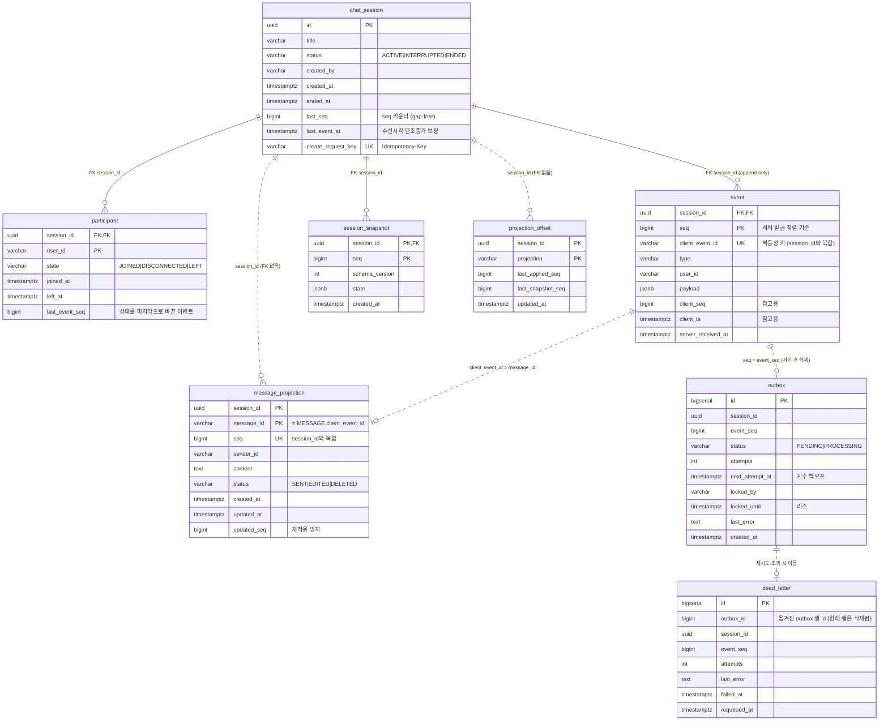

# DB 설계

PostgreSQL 16. DDL 원본: [`src/main/resources/db/migration/V1__init.sql`](../src/main/resources/db/migration/V1__init.sql)

## 1. 설계 원칙

> **진실의 원천(source of truth)은 `event` 테이블 하나다.** 나머지는 전부 이벤트에서 다시 만들 수 있는 파생 데이터다.

| 구분 | 테이블 | 갱신 방식 | 일관성 | 유실 시 |
|---|---|---|---|---|
| 원장 | `event` | append-only (INSERT만) | - | 복구 대상 (백업/PITR) |
| Write model | `chat_session`, `participant` | append와 **같은 트랜잭션** | 강한 일관성 | 원장에서 재계산 가능 |
| Read model | `message_projection` | outbox 워커가 **비동기** 갱신 | 최종 일관성 (수백 ms) | `POST /admin/projections/{id}/rebuild` |
| 복원 가속 | `session_snapshot` | 비동기 (N개마다, 세션 종료 시) | 결정적 | 삭제해도 정확성 영향 없음 (느려질 뿐) |
| 비동기 작업 | `outbox`, `projection_offset`, `dead_letter` | 트랜잭셔널 아웃박스 | - | - |

Write model을 동기로 갱신하는 이유는 **검증에 필요한 상태**이기 때문이다. 정원 2명, 참여자 여부, 종료 여부를 비동기 projection으로 판단하면, 방금 JOIN한 사용자의 메시지를 거절하는 식의 오류가 생긴다. 반면 대화창 목록(`message_projection`)은 조회 전용이라 수백 ms 지연을 허용하고, 쓰기 경로에서 분리해 append 지연을 줄였다.

## 2. ERD

실선은 DDL에 실제로 걸린 FK(`REFERENCES chat_session (id)`), 점선은 FK 없이 컬럼 값으로만 이어지는 논리적 관계다. 사용자 테이블은 없고 `user_id`는 문자열로만 저장한다.



| 관계 | FK | 비고 |
|---|---|---|
| `participant`, `event`, `session_snapshot` → `chat_session` | ✓ | 세션 1 : N |
| `message_projection`, `projection_offset` → `chat_session` | ✗ | 원장에서 다시 만들 수 있는 파생 데이터라 FK를 두지 않았다 |
| `message_projection.message_id` → `event.client_event_id` | ✗ | MESSAGE 이벤트 1건 = 메시지 1행. 수정·삭제 이벤트가 같은 행을 갱신 |
| `outbox.(session_id, event_seq)` → `event.(session_id, seq)` | ✗ | 같은 트랜잭션(CTE)에서 생성, 처리 후 삭제 |
| `dead_letter.outbox_id` → `outbox.id` | ✗ | 옮길 때 outbox 행이 삭제되고, requeue하면 새 outbox 행이 생기므로 FK를 걸 수 없다 |

## 3. 핵심 DDL

```sql
CREATE TABLE chat_session (
    id                  UUID         PRIMARY KEY,
    title               VARCHAR(200),
    status              VARCHAR(16)  NOT NULL,              -- ACTIVE | INTERRUPTED | ENDED
    created_by          VARCHAR(64)  NOT NULL,
    created_at          TIMESTAMPTZ  NOT NULL,
    ended_at            TIMESTAMPTZ,
    last_seq            BIGINT       NOT NULL DEFAULT 0,    -- 마지막으로 발급한 seq
    last_event_at       TIMESTAMPTZ  NOT NULL,              -- 세션 내 server_received_at 단조 증가 보장
    create_request_key  VARCHAR(64)  UNIQUE                 -- POST /sessions Idempotency-Key
);

CREATE TABLE event (
    session_id          UUID         NOT NULL REFERENCES chat_session (id),
    seq                 BIGINT       NOT NULL,
    client_event_id     VARCHAR(64)  NOT NULL,
    type                VARCHAR(32)  NOT NULL,
    user_id             VARCHAR(64)  NOT NULL,
    payload             JSONB        NOT NULL DEFAULT '{}'::jsonb,
    client_seq          BIGINT,
    client_ts           TIMESTAMPTZ,
    server_received_at  TIMESTAMPTZ  NOT NULL,
    PRIMARY KEY (session_id, seq),
    CONSTRAINT uq_event_client_event_id UNIQUE (session_id, client_event_id)
);
CREATE INDEX idx_event_session_received ON event (session_id, server_received_at, seq);

CREATE TABLE session_snapshot (
    session_id      UUID         NOT NULL REFERENCES chat_session (id),
    seq             BIGINT       NOT NULL,
    schema_version  INT          NOT NULL,
    state           JSONB        NOT NULL,
    created_at      TIMESTAMPTZ  NOT NULL DEFAULT now(),
    PRIMARY KEY (session_id, seq)
);

CREATE TABLE participant (
    session_id      UUID         NOT NULL REFERENCES chat_session (id),
    user_id         VARCHAR(64)  NOT NULL,
    state           VARCHAR(16)  NOT NULL,                  -- JOINED | DISCONNECTED | LEFT
    joined_at       TIMESTAMPTZ  NOT NULL,
    left_at         TIMESTAMPTZ,
    last_event_seq  BIGINT       NOT NULL,
    PRIMARY KEY (session_id, user_id)
);
CREATE INDEX idx_participant_user ON participant (user_id, session_id);

CREATE TABLE message_projection (
    session_id   UUID          NOT NULL,
    message_id   VARCHAR(64)   NOT NULL,
    seq          BIGINT        NOT NULL,
    sender_id    VARCHAR(64)   NOT NULL,
    content      TEXT,
    status       VARCHAR(16)   NOT NULL,
    created_at   TIMESTAMPTZ   NOT NULL,
    updated_at   TIMESTAMPTZ   NOT NULL,
    updated_seq  BIGINT        NOT NULL,
    PRIMARY KEY (session_id, message_id)
);
CREATE UNIQUE INDEX idx_msgproj_session_seq ON message_projection (session_id, seq DESC);
```

## 4. 인덱스 설계 근거 (핫패스 중심)

| 쿼리 (호출 빈도) | 인덱스 | 근거 |
|---|---|---|
| **append: 중복 확인** (메시지마다) | `UNIQUE (session_id, client_event_id)` | 중복 판정과 동시성 방어를 하나의 제약으로 처리. 수정/삭제 대상 메시지 조회(`messageId` = `client_event_id`)에도 재사용 |
| **append: 락 + seq 발급** (메시지마다) | `chat_session` PK | `UPDATE … WHERE id = ? RETURNING` 1건 |
| **resume / 리플레이 / gap-fill** (재연결마다) | `event` PK `(session_id, seq)` | `seq > ? AND seq <= ? ORDER BY seq` → 인덱스 범위 스캔, 정렬 없음. PK라 별도 인덱스 비용 없음 |
| **timeline: 시각 → seq 변환** | `(session_id, server_received_at, seq)` | 역방향 스캔 `LIMIT 1`. seq와 수신 시각이 세션 내에서 같은 방향으로 증가하므로 시각 1건만 찾으면 된다 |
| **timeline: 스냅샷 찾기** | `session_snapshot` PK `(session_id, seq)` | `seq <= ? ORDER BY seq DESC LIMIT 1` → 1건 |
| **대화창 페이지** (입장/스크롤마다) | `message_projection (session_id, seq DESC)` | keyset `seq < ? ORDER BY seq DESC LIMIT 50` |
| **세션 목록** | `chat_session (status, created_at DESC, id DESC)`, `(created_at DESC, id DESC)` | 필터 + 정렬 키 순서가 인덱스와 일치 → keyset 페이지네이션, OFFSET 없음 |
| **내 세션 목록** | `participant (user_id, session_id)` | 사용자 → 세션 (자세한 내용과 한계는 query-optimization.md 참고) |
| **outbox 폴링** | 부분 인덱스 `(next_attempt_at, id) WHERE status='PENDING'` | 처리 대상만 인덱싱 → 대기열이 커져도 작은 인덱스를 순서대로 읽음 |
| **outbox 리스 회수** (워커 크래시) | 부분 인덱스 `(locked_until) WHERE status='PROCESSING'` | 처리 중인 행만 인덱싱 → 만료된 리스를 빠르게 찾음 |
| **outbox 세션 정리** (따라잡기 후) | `(session_id, event_seq)` | `event_seq <= applied`인 행을 한 번에 삭제(coalescing) |
| **DLQ 조회 / requeue** | 부분 인덱스 `(failed_at) WHERE requeued_at IS NULL` | 미처리 항목만 인덱싱 |

**의도적으로 만들지 않은 인덱스**

- `event (type)`, `event (user_id)`: 원장은 쓰기 비중이 압도적이다. 인덱스가 하나 늘 때마다 모든 append의 쓰기 비용이 늘어난다. 타입이나 사용자 단위 분석은 원장이 아니라 projection이나 분석 DB(CDC)에서 한다.
- `event.payload` GIN: payload 내부를 검색하는 요구가 없다. 메시지 검색이 필요해지면 별도 검색 projection(예: OpenSearch)으로 분리한다.

## 5. 정규화 / 비정규화 / JSONB 선택

| 결정 | 선택 | 트레이드오프 |
|---|---|---|
| 이벤트 payload | **JSONB** | 이벤트 타입마다 필드가 다르고(text, messageId, upToSeq…) 버전에 따라 늘어난다. 타입별 테이블은 리플레이 때 UNION/JOIN이 필요하다. 대신 DB 수준 스키마 검증이 없어 **애플리케이션에서 검증**한다(`EventAppendService.validate`). |
| 스냅샷 상태 | **JSONB 통째 저장** | 항상 통째로 읽고 쓰는 값이라 정규화할 이유가 없다. 상태 구조가 바뀌면 `schema_version`을 올려 기존 스냅샷을 무시하면 된다(원장에서 재생성). 단점은 메시지가 많은 세션의 스냅샷 크기 증가로, 5절에서 다룬다. |
| `chat_session.last_seq` | **비정규화 카운터** | `max(seq)+1`을 쓰면 동시성 문제가 있고(같은 값을 두 번 발급), 시퀀스 객체를 쓰면 gap이 생긴다(롤백 시 소비됨). 행 락 아래 카운터는 gap-free와 직렬화를 동시에 해결한다. 비용은 세션 단위 직렬화인데, 1:1 세션은 세션당 쓰기 빈도가 낮아 문제가 되지 않는다. |
| `participant`, `chat_session.status` | **비정규화 (원장에서 파생)** | 매 검증마다 리플레이할 수 없으므로 현재 상태를 테이블로 유지한다. 같은 트랜잭션에서 갱신하므로 원장과 어긋나지 않는다. |
| `message_projection` | **비정규화 read model** | 대화창 조회에서 수정/삭제를 매번 합산하지 않도록 미리 계산한다(CQRS). |
| `message_id` | **`client_event_id` 재사용** | 별도 ID 발급이 필요 없다. 클라이언트가 ack 전에도 자기 메시지를 식별할 수 있다(낙관적 UI). |

### 스냅샷 크기 문제 (현재 한계와 개선안)

현재 스냅샷은 세션의 **전체 메시지 맵**을 포함한다. 수정이나 삭제가 오래된 메시지를 가리킬 수 있어서다. 1:1 대화는 대부분 수백~수천 메시지라 TOAST 압축으로 충분하지만(seq 400 스냅샷 약 9KB), 메시지가 수십만 건인 장기 세션이라면 다음 방식으로 바꾼다.

- **메시지 상태를 스냅샷에서 분리**: 스냅샷에는 참여자, 읽음 포인터, 카운터만 둔다. 시점 t의 메시지 목록은 "seq ≤ k인 MESSAGE 중 최근 N개 + 그 메시지들을 대상으로 한 seq ≤ k인 수정/삭제"로 범위 질의한다. 필요 인덱스는 `event (session_id, type, seq)`와 수정/삭제의 대상 메시지 ID 컬럼(정규화 추출)이다.
- **증분 스냅샷**: 직전 스냅샷 대비 변경된 메시지만 저장하고 체인으로 복원한다.

## 6. 데이터 증가 대응

- **파티셔닝**: `event`를 `server_received_at` 기준 월 단위 RANGE 파티션으로 나눈다. PK에 파티션 키를 포함해야 하므로 PK를 `(session_id, seq, server_received_at)`로 바꾸고, 유니크 제약도 파티션 로컬로 바뀐다. 따라서 멱등성 키 유일성은 "같은 월 안"으로 약해진다. 재전송은 보통 수 초~수 분 안에 일어나므로 실질적인 위험은 낮지만, 월 경계 이벤트를 보완하려면 Redis 멱등 캐시(TTL 24h)를 앞단에 두는 방법을 쓸 수 있다.
- **아카이빙**: 종료 후 N일 지난 세션은 최종 스냅샷을 남긴 뒤 원장을 오브젝트 스토리지(Parquet)로 옮긴다. 복원 요청이 오면 콜드 경로에서 읽는다.
- **해시 샤딩**: 단일 DB의 쓰기 한계에 도달하면 `session_id` 해시로 샤딩한다. 모든 핫패스 쿼리가 `session_id`를 조건으로 갖도록 설계했으므로 크로스 샤드 쿼리가 없다. 세션 목록만 예외라 별도의 검색용 저장소가 필요하다.
