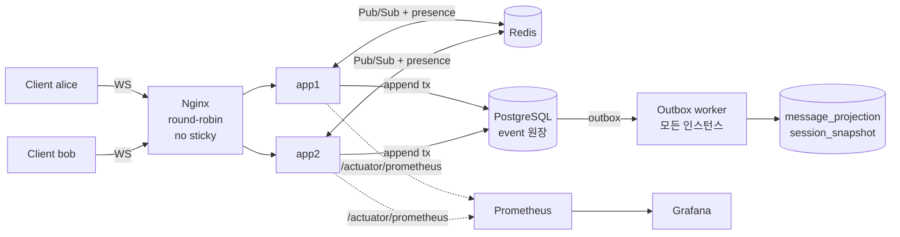

# 설계 문서

## 0. 전체 구조



메시지 1건의 처리 순서는 다음과 같다.

1. 클라이언트가 `send{clientEventId}`를 보낸다.
2. 서버가 한 트랜잭션에서 다음을 처리한다.
   - 세션 행을 잠그고 seq를 발급한다.
   - 중복을 확인한다.
   - 검증한다.
   - event와 outbox를 INSERT한다.
3. COMMIT 후 송신자에게 `ack{seq}`를 보낸다.
4. 세션 레인에서 로컬 연결로 전달하고, Redis로 다른 인스턴스에 전달한다.
5. 별도로 outbox 워커가 projection과 snapshot을 갱신한다.

### 기술 스택 선택 근거

| 영역 | 선택 | 근거 / 대안 |
|---|---|---|
| 언어 | Java 21 + Spring Boot 3.5 | 성숙한 생태계(WebSocket, JDBC, Micrometer, Testcontainers). Boot 4.x는 Jackson 3 전환 등 변경이 커서 안정성을 우선했다 |
| 실시간 | Spring WebSocket (**순수 WS + 자체 JSON 프로토콜**) | STOMP는 구독/브로커 모델이라 ack, seq, resume 규약을 프로토콜 밖에서 다시 정의해야 한다. 이번 과제의 핵심인 재연결 정합성을 직접 설계하고 설명하려고 순수 WS를 택했다 |
| DB 접근 | JdbcTemplate (JPA 미사용) | 핫패스가 `ON CONFLICT`, `RETURNING`, CTE, `SKIP LOCKED` 등 PostgreSQL 고유 기능 위주다. JPA의 영속성 컨텍스트와 dirty checking이 주는 이점보다 SQL을 직접 통제하는 이점이 컸다. *초기 계획(JPA + JdbcTemplate)에서 변경* |
| DB | PostgreSQL 16 | 트랜잭션, 행 락, 부분 인덱스, JSONB, `SKIP LOCKED` |
| 브로커 | Redis Pub/Sub (Kafka 미사용) | 팬아웃은 유실돼도 원장에서 복구 가능한 최선 노력(best-effort) 경로라 at-most-once로 충분하다. Kafka는 내구성 있는 로그가 필요해지는 시점(CDC, 분석, 멀티 리전)에 도입한다 |
| 비동기 | Transactional Outbox (DB 폴링) | 별도 브로커 없이 "이벤트 저장과 작업 등록의 원자성"을 보장한다 |

## 1. 중복 이벤트 처리 (요구사항 2.1)

**방어선을 세 겹으로 둔다.**

| 계층 | 방법 | 막는 것 |
|---|---|---|
| 클라이언트 | 이벤트마다 `clientEventId`(UUID)를 붙이고, 재전송 시 **같은 ID**를 쓴다 | 재전송 식별 |
| 서버 로직 | 세션 행 락을 잡은 뒤 `(session_id, client_event_id)`로 조회한다. 있으면 롤백하고 **기존 seq로 `DUPLICATE` ack**를 보낸다 | 중복 저장, 중복 브로드캐스트 |
| DB 제약 | `UNIQUE (session_id, client_event_id)` + `ON CONFLICT DO NOTHING` | 로직 버그 시 최종 방어 |

- 같은 ID로 **다른 내용**을 보내면 409 `IDEMPOTENCY_KEY_REUSED`를 반환한다. 조용히 무시하면 클라이언트 버그가 데이터 유실로 이어진다.
- 상태성 이벤트(JOIN/LEAVE/DISCONNECT/RECONNECT)는 ID가 달라도 상태 전이가 없으면 `NOOP`이다. 예를 들어 이미 JOINED인 사용자의 JOIN은 기록되지 않는다.
- 서버 생성 이벤트는 **결정적 ID**를 쓴다. 예: `sys:disconnect:{connId}`. 그래서 정상 종료 처리와 장애 인스턴스 정리(sweeper)가 동시에 같은 연결을 처리해도 한 번만 기록된다.
- 세션 생성은 `Idempotency-Key` 헤더 → `create_request_key UNIQUE`로 처리한다.
- **검증:** 32개 스레드가 같은 이벤트를 동시에 재전송해도 저장은 1건이다(`concurrentRetriesOfSameEventAreStoredOnce`). DB 장애 중 재시도 후 복구돼도 1건이다(`scripts/chaos/db-pause.mjs`).

## 2. 순서 기준 (요구사항 2.2)

**유일한 정렬 기준은 서버가 세션별로 발급하는 `seq`다.** seq는 1부터 시작하고 gap-free이며 단조 증가한다.

| 후보 | 채택 여부 | 이유 |
|---|---|---|
| 클라이언트 시각 `client_ts` | ✗ (저장만) | 기기마다 시계가 다르고 조작 가능하다 |
| 서버 수신 시각 | ✗ (정렬용 아님) | 인스턴스 간 시계 오차가 있고, 같은 시각에 도착한 이벤트끼리 순서를 정할 수 없다 |
| 클라이언트 순번 `client_seq` | ✗ (관측용) | 송신자 1명 안의 순서일 뿐, 두 사람 사이의 순서는 정하지 못한다. 구멍은 `chat.client.seq.gap` 메트릭으로 관측만 한다 |
| **서버 seq** | ✓ | 세션 행 락 아래에서 발급한다. 동시 요청이 와도 중복이나 구멍이 없다 |

- **수신 시각과의 관계:** `server_received_at = GREATEST(DB clock_timestamp(), 직전 이벤트 시각)`로 세션 안에서 seq와 같은 방향으로 증가시킨다. 시계는 DB 하나만 쓴다. 따라서 "시각 t까지의 상태"는 "seq ≤ k까지의 상태"와 같은 집합이 된다.
- **순서 뒤바뀜 규칙:** 원본 메시지보다 수정/삭제가 먼저 도착하면 서버가 `422 TARGET_NOT_FOUND (retryable)`로 거절한다. 클라이언트는 원본의 ack를 받은 뒤 같은 ID로 재시도한다. 그래서 **원장에는 항상 인과 순서가 지켜진 이벤트만 저장된다.** 보류 큐를 서버에 두지 않은 이유는, 원본이 영영 오지 않을 수도 있어 보류된 수정의 수명과 정리 정책이 별도로 필요해지기 때문이다.
- **수신 측 순서:** 클라이언트는 연결마다 seq가 1씩 증가하는 스트림만 받는다(EventDelivery). 세부 동작은 3절에 있다.

## 3. 재연결 시 데이터 정합성

```
클라이언트: lastSeq = 마지막으로 받은 seq
재연결: ws /ws?sessionId&userId&lastSeq=41

서버:
 1. 참여자 검증, lastSeq 검증 (숫자 아님·음수 → close 4400, 서버 최신 seq보다 큼 → close 4422)
 2. welcome{serverLastSeq:57, resumeFrom:41}
 3. 레지스트리 등록 (지금부터 live 이벤트 수신 시작)
 4. presence ONLINE, 다른 인스턴스의 이전 연결 KICK (사용자당 1연결)
 5. DISCONNECTED 상태였다면 RECONNECT 이벤트 기록
 6. 원장에서 (41, 현재] 재전송
    → 3번 이후 도착한 live 이벤트와 겹치면 seq 로 중복 제거, 앞서면 재정렬 버퍼에서 대기
```

**연결별 전송 불변식 (`EventDelivery`):** `lastSentSeq` 기준으로 판단한다.

| 도착한 seq | 처리 |
|---|---|
| `seq <= lastSentSeq` | 버린다 (resume과 live의 겹침, Redis 중복 수신) |
| `seq == lastSentSeq + 1` | 보내고, 보관 중인 후속 이벤트를 이어서 보낸다 |
| `seq > lastSentSeq + 1` | 재정렬 버퍼에 보관하고 200ms 대기한다. 그래도 빈 seq가 없으면 원장에서 채운다(gap-fill) |

**조용한 대화의 유실:** gap-fill은 다음 이벤트가 와야 동작하므로, 마지막 이벤트가 Redis에서 유실되면 위 불변식만으로는 발견하지 못한다. 그래서 `ping`마다 서버가 원장의 최신 seq와 그 연결의 `lastSentSeq`를 비교해 빠진 이벤트를 먼저 보내고 `pong{serverLastSeq}`로 답한다(`silentlyLostLastEventIsRecoveredOnPingWithoutNewEvents`, `redis-down.mjs`).

**잘못된 `lastSeq`:** 숫자가 아니거나 음수면 close 4400, 서버의 최신 seq보다 크면 close 4422로 거절한다. 조용히 낮춰 받으면 클라이언트가 그 사이 이벤트를 "이미 받음"으로 버려 유실된다.

**결과:** 클라이언트는 resume 도중이든, Redis가 메시지를 잃든, 인스턴스가 바뀌든 **gap 없고 중복 없는 순서대로의 스트림**을 받는다. 부하 테스트 11만 건과 장애 주입 3종에서 `seq_gap = 0`이었다.

**연결 상태 이벤트**

- 비정상 종료 → `DISCONNECT{reason, connId}`, 세션 상태는 `INTERRUPTED`가 된다.
- 재연결 → `RECONNECT`, 세션 상태는 `ACTIVE`로 돌아간다.
- 같은 사용자가 새로 연결되면 이전 연결은 4001로 닫히고 DISCONNECT를 기록하지 않는다.
- presence 키에 `connId`를 넣어 **소유자만 삭제**(compare-and-delete Lua)한다. 그래서 "이전 연결의 종료 처리"와 "새 연결 수립"이 경합해도 새 연결의 presence가 지워지지 않는다.
- 그래도 경합으로 잘못된 DISCONNECT가 기록되면, 살아있는 연결이 자기 DISCONNECT를 받는 순간 RECONNECT를 기록해 바로잡는다(자가 치유).

## 4. 수평 확장: 세션 분산과 상태 저장

| 상태 | 위치 | 이유 |
|---|---|---|
| 이벤트 원장, 참여자, seq | PostgreSQL | 유일한 진실의 원천 |
| WebSocket 연결 | 각 인스턴스 메모리 | 연결은 프로세스에 묶여 있다. 인스턴스가 죽으면 연결도 끊긴다 |
| presence, 인스턴스 생존 | Redis (TTL) | 인스턴스 간 공유. 휘발성이라 유실돼도 원장에 영향 없다 |
| 인스턴스 간 팬아웃 | Redis Pub/Sub | at-most-once. 유실은 gap-fill/resume이 원장에서 복구한다 |

- **세션 고정(sticky) 없음:** 1:1 세션의 두 사용자가 다른 인스턴스에 붙어도 된다. 앱 서버에 세션 상태가 없으므로 인스턴스를 추가하거나 제거해도 재분배 작업이 없다.
- **로컬 우선 전달:** 같은 인스턴스의 연결에는 Redis를 거치지 않고 바로 보낸다. 그래서 Redis가 장애여도 같은 인스턴스 사용자끼리는 통신이 유지된다(`redis-down.mjs`로 검증).
- **확장 한계와 다음 단계:**
  - 현재는 모든 인스턴스가 단일 채널 `chat:bus`를 구독한다. 인스턴스가 N개면 메시지 하나가 N번 전달된다.
  - 수십 대 규모라면 다음 둘 중 하나로 바꾼다. (a) 세션별 채널을 동적으로 구독하거나 Redis 7 sharded pub/sub(`SSUBSCRIBE`)를 쓴다. (b) **consistent hashing으로 세션을 인스턴스에 할당**하고 LB가 `sessionId` 기준으로 라우팅한다. (b)는 팬아웃 자체가 필요 없어진다.
  - 쓰기는 단일 PostgreSQL이 상한이다(측정 기준 초당 약 1,850건). 그다음은 `session_id` 해시 샤딩이다.
- **outbox 워커:** 모든 인스턴스에서 실행된다. `SKIP LOCKED` claim과 세션 체크포인트 락으로 일을 나눠 가지므로, 인스턴스가 늘면 처리량도 는다.

## 5. 비동기 처리 구조 (Projection / Snapshot)

```mermaid
sequenceDiagram
    participant API as append tx
    participant OB as outbox
    participant W as worker (N 인스턴스 × 4 스레드)
    participant OFF as projection_offset (세션별 락)
    participant P as message_projection / snapshot
    API->>OB: INSERT (event 와 같은 트랜잭션)
    W->>OB: claim (PENDING & due, FOR UPDATE SKIP LOCKED, 리스 30s)
    W->>OFF: SELECT ... FOR UPDATE (세션 직렬화)
    W->>P: last_applied_seq 이후 이벤트를 seq 순으로 적용
    W->>P: seq 가 100의 배수를 지날 때마다 스냅샷
    W->>OFF: last_applied_seq 갱신 (같은 트랜잭션)
    W->>OB: 해당 세션 event_seq <= applied 일괄 삭제
    Note over W,OB: 실패 → attempts+1, next_attempt_at = now + 500ms·2^(n-1) ±20%<br/>5회 실패 → dead_letter
```

| 요구 | 설계 |
|---|---|
| 원자성 (부분 실패 방지) | event와 outbox를 한 트랜잭션(한 문장)에 기록한다. "저장은 됐는데 작업 등록이 안 됨"이 없다 |
| 재시도 | 지수 백오프(500ms 기준, 상한 60s)에 ±20% jitter를 더한다. 동시 재시도 폭주를 막는다 |
| DLQ | 5회 실패하면 `dead_letter`로 옮긴다. `GET /admin/dlq`로 조회하고, 원인을 수정한 뒤 `POST /admin/dlq/requeue`로 재처리한다 |
| Idempotency | outbox 항목은 "세션에 새 이벤트가 있다"는 신호일 뿐이다. 실제 적용 범위는 체크포인트 `last_applied_seq` 이후의 원장이다. 같은 항목이 두 번 처리돼도 새로 적용할 것이 없다. projection UPDATE에도 `updated_seq < ?` 조건을 걸어 이중 안전장치를 뒀다 |
| 중복 실행 방지 | claim은 `SKIP LOCKED`, 세션 적용은 `projection_offset` 행 락, 스냅샷은 `(session_id, seq)` PK + `DO NOTHING`. 상태가 결정적이라 같은 seq 스냅샷은 항상 같은 내용이다 |
| 워커 크래시 | 리스(`locked_until`)가 만료되면 다른 워커가 회수한다 (at-least-once) |
| 순서 보장 | 세션 안에서는 체크포인트 락으로 seq 순 적용, 세션끼리는 병렬 |
| Poison event | 순서 보장 projection이라 실패한 이벤트를 건너뛰지 않는다. 그 세션의 projection만 멈추고 다른 세션은 영향이 없다. 건너뛰면 수정이 원본보다 먼저 적용되는 식의 오염이 생기므로 **멈추고 알리는 쪽**을 택했다. 복구 후 requeue하면 이어서 처리된다 (`poisonEventIsRetriedThenDeadLetteredThenRecoveredByRequeue`) |
| 재구축 | read model은 언제든 버리고 원장에서 다시 만들 수 있다: `POST /admin/projections/{id}/rebuild` |

**동기 vs 비동기 경계:** 검증에 쓰이는 상태(참여자, 세션 상태)는 동기, 조회 전용 상태(대화창 목록, 스냅샷)는 비동기다. 시점 복원 API는 projection이 아니라 **원장을 직접 리플레이**한다. 스냅샷은 시작점일 뿐이다. 그래서 projection이 지연되거나 DLQ에 걸려도 복원 결과는 항상 정확하다.

## 6. 관측 가능성

### 로그
- 컨테이너에서는 `SPRING_PROFILES_ACTIVE=json`으로 logstash JSON 로그를 낸다. MDC의 `traceId`, `spanId`, `sessionId`, `userId`, `connId`가 필드로 출력된다.
- 주요 이벤트를 로그로 남긴다: 중복 무시, gap-fill, 재시도와 DLQ 이동, 장애 인스턴스 정리, WS 연결/종료(종료 코드와 이유 포함).

### 추적 (Tracing)
- Micrometer Tracing(Brave)을 쓴다. HTTP 요청은 자동으로 trace가 생성된다.
- **WebSocket 프레임**은 HTTP 요청이 아니라 자동 추적이 안 되므로, 프레임마다 span을 수동으로 연다(`ChatWebSocketHandler.withContext`).
- **Redis 버스 메시지에 `traceId`를 실어** 수신 인스턴스 로그에서도 같은 traceId로 이어진다. app1에서 보낸 메시지가 app2의 사용자에게 전달되는 과정을 traceId 하나로 검색할 수 있다.
- 오류 응답 본문에 `traceId`를 넣어 사용자 문의와 로그를 연결한다.
- 현재는 exporter 없이 로그 상관관계까지만 구현했다. 운영에서는 OTLP exporter → Tempo/Jaeger를 붙이면 된다(의존성 1개, 설정 1줄).

### 메트릭 (Prometheus, Grafana 대시보드 `infra/grafana/dashboards/realtime-chat.json`)

| 메트릭 | 의미 | 알람 예시 |
|---|---|---|
| `chat_append_latency` (histogram) | append 트랜잭션 지연 | p99 > 200ms 5분 |
| `chat_events_appended/duplicate/rejected_total{type,channel,code}` | 수집량, 중복률, 거절 사유 | 중복률 급증 = 클라이언트 재시도 폭주 |
| `chat_ws_connections` | 인스턴스별 연결 수 | 인스턴스 간 불균형 |
| `chat_delivery_reordered/gap_filled_total` | 순서 역전, 원장 보충 | gap-fill 급증 = Redis 유실/지연 |
| `chat_outbox_pending`, `chat_outbox_oldest_age_seconds` | 비동기 backlog, **projection 지연** | 지연 > 30s 5분 |
| `chat_dead_letters` | 미처리 DLQ | > 0 즉시 |
| `chat_restore_latency`, `chat_restore_replayed_events` | 복원 지연, 리플레이 길이 | 리플레이 평균 > 스냅샷 주기 = 스냅샷 생성 실패 |
| `chat_presence_instance_swept_total` | 장애 인스턴스 정리 | 발생 시 알림 |
| `hikaricp_connections_pending/active` | 커넥션 고갈 | pending > 0 1분 |
| `http_server_requests` (histogram) | API 지연, 오류율 | 5xx 비율 |

## 7. 장애 대응

[incident-response.md](incident-response.md)에 있다. 서버 다운, DB 장애, 데이터 정합성 이슈 각각을 감지 → 완화 → 복구 흐름으로 정리했고, 재현 스크립트를 함께 넣었다.
