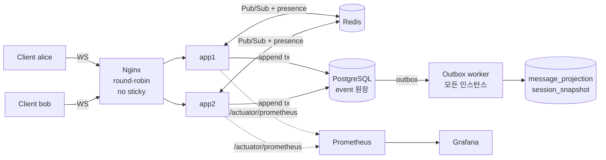

# 설계 문서 (Plan)

1:1 실시간 채팅 백엔드. 모든 상태 변화를 **append-only 이벤트 원장**에 기록하고, 원장을 리플레이해 **임의 시점의 세션 상태를 결정적으로 복원**한다.

이 문서는 전체 설계를 한곳에 요약한다. 절마다 상세 문서를 링크했다.

---

## 1. 목표와 범위

### 1.1 필수 요구사항과 구현

| 요구사항 | 설계 | 상세 |
|---|---|---|
| 실시간 메시지 송수신 | WebSocket `/ws` + 자체 JSON 프로토콜 (send → ack{seq} → event 팬아웃) | [websocket-protocol.md](docs/websocket-protocol.md) |
| join / leave | REST `POST /sessions/{id}/join`, `/leave`, WS `leave` 프레임. 정원 2명, 멱등 | §4.2 |
| presence | Redis TTL 기반 ONLINE/OFFLINE + 원장의 DISCONNECT/RECONNECT 이벤트 → 세션 상태 `INTERRUPTED` | §5.4 |
| 이벤트 수집 API | `POST /sessions/{id}/events` (배치, 이벤트별 결과) + WS `send` | §5.1 |
| 중복 방지 | `clientEventId` 멱등성 키 + 세션 락 아래 확인 + DB `UNIQUE` 제약 | §5.1 |
| 순서 뒤바뀜 처리 기준 | 서버가 세션별로 발급하는 gap-free `seq`가 유일한 기준 | §5.2 |
| 특정 시점 상태 복원 | `GET /sessions/{id}/timeline?at=` (또는 `?seq=`), 스냅샷 + 리플레이 | §5.5 |

### 1.2 가정

- 1:1 세션: 동시에 참여할 수 있는 사용자는 최대 2명이다. LEAVE 후 재참여할 수 있다.
- 사용자 식별은 신뢰된 헤더(`X-User-Id`)와 WS 쿼리(`userId`)로 한다. 인증은 비목표다.
- 사용자당 세션 연결은 1개다. 새 연결이 이전 연결을 대체한다.
- 메시지 ID는 MESSAGE 이벤트의 `clientEventId`다.
- 시점 복원의 기준 시각은 **서버 수신 시각**이다.
- typing indicator는 휘발성 신호라 저장하거나 복원하지 않는다.

### 1.3 비목표 (문서로만 설계)

| 항목 | 문서 |
|---|---|
| 인증/인가 | - |
| 대용량 세션의 스냅샷 크기 최적화 (메시지 분리, 증분 스냅샷) | [db-design.md §5](docs/db-design.md) |
| 파티셔닝 / 아카이빙 / 해시 샤딩 | [db-design.md §6](docs/db-design.md) |
| 트레이스 exporter (OTLP → Tempo/Jaeger) | [design.md §6](docs/design.md) |
| 삭제된 메시지 원문의 완전 삭제 (crypto-shredding) | [event-sourcing.md §3](docs/event-sourcing.md) |

---

## 2. 핵심 설계 결정

| # | 결정 | 이유 | 대가 |
|---|---|---|---|
| 1 | **진실의 원천은 `event` 테이블 하나** | 참여자·상태·대화창·스냅샷이 모두 원장에서 다시 만들어지는 파생 데이터가 된다. 복원과 장애 복구가 단순해진다 | 원장이 계속 커진다 (아카이빙 필요) |
| 2 | **seq는 세션 행 락 아래 카운터로 발급** | 시퀀스 객체(롤백 시 구멍)나 `max+1`(경합) 대신 gap-free를 보장한다. 구멍이 있으면 "누락"으로 판정할 수 있다 | 세션 단위로 쓰기가 직렬화된다. 1:1 대화에선 무시할 수준 |
| 3 | **순서 역전은 서버가 거절하고 클라이언트가 재시도** | 원본보다 먼저 온 수정은 422 retryable. 원장에는 인과 순서가 지켜진 이벤트만 존재한다 | 클라이언트가 재시도 규칙을 지켜야 한다 |
| 4 | **실시간 팬아웃은 at-most-once (Redis), 정합성은 원장이 책임** | 유실은 재정렬 버퍼 → gap-fill → resume으로 원장에서 복구한다. 그래서 Kafka 없이 충분하다 | Redis 장애 시 다른 인스턴스 사용자는 복구까지 실시간 수신이 지연된다 |
| 5 | **Transactional Outbox** | 이벤트 저장과 비동기 작업 등록을 한 트랜잭션으로 묶어 부분 실패를 없앤다 | DB 폴링 비용 |
| 6 | **스냅샷은 정확한 경계(seq % 100 == 0)에서** | 어떤 시점이든 리플레이가 최대 99건으로 상한이 정해진다 | 스냅샷 저장 공간 |
| 7 | **Reducer는 순수 함수** | 같은 이벤트 → 항상 같은 상태. 스냅샷 경로와 전체 리플레이를 언제든 대조할 수 있다(`verify=true`) | 시각·난수·DB를 reducer 안에서 쓸 수 없다 |
| 8 | **성능보다 정합성** | `synchronous_commit=off` 같은 지연 개선책은 ack 후 유실 가능성 때문에 채택하지 않았다 | 쓰기 처리량 상한이 DB commit 속도로 정해진다 |

### 기술 스택

| 영역 | 선택 | 근거 |
|---|---|---|
| 언어/프레임워크 | Java 21, Spring Boot 3.5 | WebSocket, JDBC, Micrometer, Testcontainers 생태계 |
| 실시간 | Spring WebSocket + 자체 JSON 프로토콜 (STOMP 미사용) | ack·seq·resume 규약을 직접 설계하고 통제하기 위해 |
| DB 접근 | JdbcTemplate (JPA 미사용) | 핫패스가 `ON CONFLICT`, `RETURNING`, `SKIP LOCKED` 등 PostgreSQL 고유 기능 위주 |
| 저장소 | PostgreSQL 16, Redis 7 | 트랜잭션·행 락·JSONB / TTL·Pub/Sub |
| 관측 | Micrometer, Prometheus, Grafana, logstash JSON 로그 | 도메인 메트릭 20종, 대시보드 15패널 |

---

## 3. 아키텍처



### 메시지 1건의 처리 흐름

1. 클라이언트가 `send{clientEventId, eventType, payload}`를 보낸다.
2. 서버가 **한 트랜잭션**에서 처리한다: 세션 행 잠금 + seq 발급 → 중복 확인 → 검증 → `event`와 `outbox` INSERT → write model(참여자, 세션 상태) 갱신.
3. COMMIT 후 송신자에게 `ack{seq, status}`를 보낸다.
4. 같은 인스턴스의 연결에는 바로, 다른 인스턴스에는 Redis Pub/Sub으로 전달한다.
5. outbox 워커가 비동기로 대화창 read model과 스냅샷을 갱신한다.

### 패키지 구조

```
src/main/java/com/example/chat
├── api/          REST 컨트롤러, 세션 서비스, DTO
├── ingest/       EventAppendService: 모든 이벤트의 단일 쓰기 경로 (락·중복·검증·seq·outbox)
├── restore/      SessionReducer(순수 함수), SessionState, RestoreService, SnapshotService
├── projection/   OutboxWorker(재시도/DLQ), MessageProjector(체크포인트, 스냅샷 자동화)
├── realtime/     WebSocket 핸들러, EventDelivery(재정렬/gap-fill), Redis 버스, presence, sweeper
├── store/        JdbcTemplate 리포지토리
├── domain/       EventType, ParticipantState(상태 머신), SessionStatus
├── admin/        DLQ / projection 재구축 / chaos API
└── config/       설정, 메트릭, WebSocket/Redis/OpenAPI
```

---

## 4. 도메인 모델

### 4.1 이벤트 타입

| 타입 | 생성 주체 | payload | 저장 |
|---|---|---|---|
| `SESSION_CREATED` | `POST /sessions` | `title` | ✓ |
| `JOIN` / `LEAVE` | REST API, WS `leave` 프레임 | - | ✓ |
| `DISCONNECT` | 서버 (비정상 연결 종료, 장애 인스턴스 정리) | `reason`, `connId` | ✓ |
| `RECONNECT` | 서버 (DISCONNECTED 상태에서 재연결) | `connId` | ✓ |
| `MESSAGE` | 클라이언트 | `text` | ✓ |
| `MESSAGE_EDITED` / `MESSAGE_DELETED` | 클라이언트 (작성자 본인만) | `messageId`, (`text`) | ✓ |
| `READ` | 클라이언트 | `upToSeq` | ✓ |
| `SESSION_ENDED` | `POST /sessions/{id}/end` | - | ✓ |
| `TYPING` | 클라이언트 | `typing` | ✗ (휘발성, WS로만 전달) |

클라이언트가 직접 보낼 수 있는 타입은 `MESSAGE`, `MESSAGE_EDITED`, `MESSAGE_DELETED`, `READ`뿐이다. 나머지는 전용 API나 서버가 만든다. 서버가 만드는 이벤트는 결정적 ID(예: `sys:disconnect:{connId}`)를 써서, 여러 경로가 동시에 처리해도 한 번만 기록된다.

### 4.2 참여자 상태 머신

```
(none | LEFT)  --JOIN-->        JOINED
JOINED         --DISCONNECT-->  DISCONNECTED
DISCONNECTED   --RECONNECT-->   JOINED
(JOINED | DISCONNECTED) --LEAVE--> LEFT
```

규칙에 맞지 않는 전이(이미 JOINED인데 JOIN 등)는 기록하지 않는다(`NOOP`, seq 미소비). write model과 복원 reducer가 같은 전이 규칙(`ParticipantState.transition`)을 공유하므로, 실시간 검증 결과와 복원 결과가 항상 같다.

### 4.3 세션 상태

| 상태 | 조건 |
|---|---|
| `ACTIVE` (진행중) | 종료되지 않았고, 연결이 끊긴 참여자가 없음 |
| `INTERRUPTED` (중단) | 종료되지 않았고, DISCONNECTED 상태의 참여자가 있음 |
| `ENDED` (완료) | `SESSION_ENDED` 이후. 새 이벤트를 거절한다 |

세션 상태는 저장된 값이 아니라 참여자 상태에서 **파생**한다(`SessionStatus.derive`). 그래서 복원 시점의 상태도 같은 규칙으로 계산된다.

---

## 5. 주요 흐름

### 5.1 이벤트 수집과 중복 방지

방어선을 세 겹으로 둔다.

| 계층 | 방법 |
|---|---|
| 클라이언트 | 이벤트마다 `clientEventId`(UUID)를 붙이고, 재전송 시 같은 ID를 쓴다 |
| 서버 로직 | 세션 행 락을 잡은 뒤 `(session_id, client_event_id)`로 조회한다. 있으면 롤백하고 **기존 seq로 `DUPLICATE` ack** |
| DB 제약 | `UNIQUE (session_id, client_event_id)` + `ON CONFLICT DO NOTHING` |

- 같은 ID로 **다른 내용**을 보내면 409 `IDEMPOTENCY_KEY_REUSED`. 조용히 무시하면 클라이언트 버그가 데이터 유실로 이어진다.
- 세션 생성은 `Idempotency-Key` 헤더로 멱등하다.

### 5.2 순서 기준

**유일한 정렬 기준은 서버가 세션별로 발급하는 `seq`다** (1부터, gap-free, 단조 증가).

| 후보 | 채택 | 이유 |
|---|---|---|
| 클라이언트 시각 | ✗ (저장만) | 기기마다 시계가 다르고 조작 가능 |
| 서버 수신 시각 | ✗ (정렬용 아님) | 인스턴스 간 시계 오차, 동시 도착 시 순서 불명 |
| 클라이언트 순번 | ✗ (관측용) | 송신자 1명 안의 순서일 뿐 |
| **서버 seq** | ✓ | 세션 행 락 아래에서 발급, 중복·구멍 없음 |

- 수신 시각은 `GREATEST(DB clock_timestamp(), 직전 이벤트 시각)`으로 seq와 같은 방향으로 증가시킨다. 그래서 "시각 t까지의 상태"와 "seq ≤ k까지의 상태"가 같은 집합이 된다.
- 원본보다 수정/삭제가 먼저 도착하면 `422 TARGET_NOT_FOUND (retryable)`. 클라이언트는 원본 ack 후 같은 ID로 재시도한다. 서버에 보류 큐를 두지 않은 이유는, 원본이 영영 오지 않을 수 있어 보류 항목의 수명 정책이 따로 필요해지기 때문이다.

### 5.3 실시간 전달과 재연결

클라이언트는 마지막으로 받은 `lastSeq`로 재연결(`/ws?sessionId&userId&lastSeq=`)하고, 서버는 `(lastSeq, 현재]`를 원장에서 재전송한다.

연결마다 `lastSentSeq` 기준으로 다음 불변식을 지킨다(`EventDelivery`).

| 도착한 seq | 처리 |
|---|---|
| `≤ lastSentSeq` | 버림 (resume과 live의 겹침, Redis 중복) |
| `== lastSentSeq + 1` | 전송, 보관 중인 후속 이벤트도 이어서 전송 |
| `> lastSentSeq + 1` | 재정렬 버퍼에 보관 후 200ms 대기, 그래도 비면 원장에서 채움(gap-fill) |

결과적으로 클라이언트는 resume 중이든, Redis가 메시지를 잃든, 인스턴스가 바뀌든 **구멍과 중복이 없는 seq 순 스트림**을 받는다.

### 5.4 Presence

- **접속 여부:** Redis 키(TTL 30s)를 연결 소유자(`connId`)만 갱신·삭제한다(compare-and-delete Lua). 이전 연결의 종료 처리가 새 연결의 presence를 지우지 않는다.
- **세션 참여 상태:** 비정상 종료 시 `DISCONNECT` → 세션 `INTERRUPTED`, 재연결 시 `RECONNECT` → `ACTIVE`. 사용자당 연결 1개를 유지하려고, 새 연결이 생기면 다른 인스턴스의 이전 연결을 KICK(close 4001)한다.
- **인스턴스 장애:** 인스턴스 하트비트 키(TTL 15s)가 만료되고 sweeper가 5초 간격으로 2회 연속 확인하면, 그 인스턴스의 연결을 `DISCONNECT(reason=instance_down)`로 기록한다. 감지까지 최대 약 25초(실측 21.8~23.5초).

### 5.5 특정 시점 상태 복원

```
at(시각) --(인덱스 역방향 1건)--> cutoffSeq
cutoffSeq --(PK 역방향 1건)--> seq ≤ cutoffSeq 인 가장 최근 스냅샷
(snapshot.seq, cutoffSeq] --(PK 범위 스캔)--> 이벤트를 reducer 에 seq 순으로 적용
```

- **복원 대상:** 세션 상태, 참여자(입장·퇴장·끊김), 메시지(전송·수정·삭제 반영), 참여자별 읽음 포인터와 안 읽은 수.
- **스냅샷:** seq가 100의 배수가 될 때마다 정확히 그 seq에서, 그리고 세션 종료 시 생성한다. 리플레이는 최대 99건이다. 스냅샷은 JSONB + `schema_version`이라 구조가 바뀌면 원장에서 다시 만들어진다.
- **결정성:** reducer는 seq 순으로만 적용하고, 이미 반영한 seq는 무시하며, seq에 구멍이 있으면 예외를 던진다. 잘못된 결과를 그럴듯하게 만들지 않는다.
- **검증:** `verify=true`이면 스냅샷 없이 처음부터 리플레이한 결과와 비교해 `verifiedAgainstFullReplay`를 돌려준다.
- **삭제된 메시지:** 복원은 그 시점 화면을 재현한다. 삭제 이전 시점이면 원문, 이후면 `DELETED`(`text: null`)다. 원문은 원장에 남는다. 완전 삭제가 필요하면 crypto-shredding을 쓴다(비목표).
- 복원은 projection을 거치지 않고 **원장을 직접** 읽는다. 그래서 비동기 처리가 지연되거나 DLQ에 걸려도 복원 결과는 정확하다.

상세: [event-sourcing.md](docs/event-sourcing.md)

### 5.6 비동기 처리 (Projection / Snapshot)

| 요구 | 설계 |
|---|---|
| 원자성 | `event`와 `outbox`를 한 트랜잭션에 기록 |
| 분산 처리 | 모든 인스턴스의 워커가 `FOR UPDATE SKIP LOCKED` + 리스(30s)로 나눠 가짐 |
| 순서 | 세션 안에서는 체크포인트(`projection_offset`) 행 락으로 seq 순 적용, 세션끼리는 병렬 |
| 멱등 | outbox 항목은 "새 이벤트가 있다"는 신호일 뿐. 실제 적용 범위는 `last_applied_seq` 이후 원장 |
| 재시도 | 지수 백오프(500ms 기준, 상한 60s) ±20% jitter |
| DLQ | 5회 실패 시 `dead_letter`로 이동, `POST /admin/dlq/requeue`로 재처리 |
| Poison event | 건너뛰지 않고 그 세션만 멈춘다 (건너뛰면 수정이 원본보다 먼저 적용되는 오염 발생) |
| 재구축 | `POST /admin/projections/{id}/rebuild`로 원장에서 다시 만듦 |

**동기/비동기 경계:** 검증에 필요한 상태(참여자, 세션 상태)는 동기로, 조회 전용 상태(대화창 목록, 스냅샷)는 비동기로 갱신한다.

---

## 6. 데이터 모델

| 구분 | 테이블 | 갱신 | 유실 시 |
|---|---|---|---|
| 원장 | `event` | INSERT만 | 복구 대상 (백업/PITR) |
| Write model | `chat_session`, `participant` | append와 같은 트랜잭션 | 원장에서 재계산 |
| Read model | `message_projection` | outbox 워커 (비동기) | 재구축 API |
| 복원 가속 | `session_snapshot` | 비동기 (100건마다, 세션 종료 시) | 삭제해도 정확성 영향 없음 |
| 비동기 작업 | `outbox`, `projection_offset`, `dead_letter` | 트랜잭셔널 아웃박스 | - |

핵심 인덱스와 제약: `event` PK `(session_id, seq)`, `UNIQUE (session_id, client_event_id)`, 수신 시각 기준 시점 조회 인덱스, 스냅샷 PK `(session_id, seq)`.

상세: [db-design.md](docs/db-design.md) (ERD, DDL, 인덱스 근거), [query-optimization.md](docs/query-optimization.md) (핫패스 쿼리 EXPLAIN)

---

## 7. API 요약

| Method | Path | 설명 |
|---|---|---|
| POST | `/sessions` | 세션 생성 (`Idempotency-Key` 지원) |
| GET | `/sessions?status=&participant=&from=&to=&cursor=&limit=` | 세션 목록 (keyset 페이지네이션) |
| GET | `/sessions/{id}` | 세션 상세 + 참여자 presence |
| POST | `/sessions/{id}/join` · `/leave` · `/end` | 참여 / 퇴장 / 종료 (멱등) |
| POST | `/sessions/{id}/events` | 이벤트 수집 (배치) |
| GET | `/sessions/{id}/events?fromSeq=&toSeq=` | 원장 조회 |
| GET | `/sessions/{id}/messages?beforeSeq=&limit=` | 대화창 (read model) |
| GET | `/sessions/{id}/timeline?at=\|seq=&limit=&verify=` | **특정 시점 상태 복원** |
| POST / GET | `/sessions/{id}/snapshots` | 스냅샷 생성 / 목록 |
| GET / POST | `/admin/dlq`, `/admin/dlq/requeue`, `/admin/projections/{id}/rebuild`, `/admin/chaos` | 운영 |
| WS | `/ws?sessionId=&userId=&lastSeq=` | 실시간 |

명세: [openapi.yaml](docs/openapi.yaml), Swagger UI `http://localhost:8080/swagger-ui.html`

---

## 8. 수평 확장과 장애 대응

### 8.1 상태 배치

| 상태 | 위치 | 이유 |
|---|---|---|
| 원장, 참여자, seq | PostgreSQL | 유일한 진실의 원천 |
| WebSocket 연결 | 각 인스턴스 메모리 | 연결은 프로세스에 묶임 |
| presence, 인스턴스 생존 | Redis (TTL) | 인스턴스 간 공유, 휘발성 |
| 인스턴스 간 팬아웃 | Redis Pub/Sub | at-most-once, 유실은 원장에서 복구 |

- **sticky 세션 없음:** 1:1 세션의 두 사용자가 서로 다른 인스턴스에 붙어도 된다. 인스턴스를 추가·제거해도 재분배가 없다.
- **로컬 우선 전달:** 같은 인스턴스 사용자끼리는 Redis를 거치지 않는다. Redis 장애 중에도 통신이 유지된다.
- **확장 한계:** 단일 채널 팬아웃은 인스턴스 수에 비례해 비용이 는다. 수십 대 규모라면 sharded pub/sub 또는 consistent hashing 라우팅으로 바꾼다. 쓰기 상한은 단일 PostgreSQL(측정 기준 초당 약 1,850건)이며, 그다음은 `session_id` 해시 샤딩이다.

### 8.2 장애 시나리오

| 장애 | 감지 | 완화 / 복구 |
|---|---|---|
| 서버 인스턴스 다운 | 하트비트 TTL 만료 + sweeper (최대 약 25초) | 다른 인스턴스로 재연결, `lastSeq` resume으로 누락·중복 없이 복구 |
| Redis 중단 | 버스 발행 실패 메트릭 | 저장은 정상. 복구 후 gap-fill로 자동 보충 |
| DB 응답 없음 | JDBC `socketTimeout=5s` | 5초 후 retryable 오류 → 클라이언트가 같은 ID로 재시도, 1건만 저장 |
| 커넥션 고갈 | Hikari `connection-timeout=3s`, pending 메트릭 | 빠르게 실패 → 재시도 |
| 정합성 이슈 | 정합성 점검 SQL, `verify=true` | projection 재구축, 스냅샷 재생성 |

상세: [incident-response.md](docs/incident-response.md)

---

## 9. 관측 가능성

- **로그:** logstash JSON. MDC의 `traceId`, `sessionId`, `userId`, `connId`가 필드로 출력된다.
- **추적:** HTTP는 자동, WebSocket 프레임은 프레임마다 span을 수동으로 연다. Redis 버스 메시지에 `traceId`를 실어 인스턴스를 넘어 이어진다. 오류 응답 본문에도 `traceId`를 넣는다.
- **메트릭:** append 지연, 중복·거절률, 연결 수, 재정렬·gap-fill, outbox backlog와 projection 지연, DLQ, 복원 지연과 리플레이 길이, 장애 인스턴스 정리 등 도메인 메트릭 20종. Grafana 대시보드 15패널이 자동 프로비저닝된다.

상세: [design.md §6](docs/design.md)

---

## 10. 검증 전략

| 수준 | 내용 | 결과 |
|---|---|---|
| 단위 테스트 73개 | reducer 결정성(무작위 순서 + 중복 200회 → 항상 같은 상태, 모든 지점에서 스냅샷+리플레이 == 전체 리플레이), 상태 머신 전 조합, 멱등성·검증 규칙, 전송 재정렬·gap-fill, outbox 백오프·DLQ | 통과 |
| 통합 테스트 17개 (Testcontainers) | 32 스레드 동시 재전송 → 1건 저장, 200건 동시 append → seq gap-free, 시점 복원 API, 스냅샷 경계, poison → DLQ → requeue, WS resume, 끊김 → 재연결 상태 전이 | 통과 |
| 시나리오 스크립트 | `smoke.sh` (REST), `ws-scenario.mjs` (서로 다른 인스턴스 간 19개 검사) | 통과 |
| 장애 주입 3종 | 인스턴스 SIGKILL, Redis 중단, DB 일시 정지 | 통과 |
| 부하 테스트 (k6) | WS 500명 초당 ~1,000건: ack p95 5~9ms(워밍업 후), seq_gap 0. 포화(초당 ~1,850건)에서도 정합성 유지 | [load-test-results.md](docs/load-test-results.md) |

```bash
./gradlew test                          # 단위 73 + 통합 17 = 90개
docker compose up -d --build
./scripts/smoke.sh
A=http://localhost:8081 B=http://localhost:8082 node scripts/ws-scenario.mjs
node scripts/chaos/instance-down.mjs    # redis-down.mjs, db-pause.mjs
```

---

## 11. 한계와 향후 작업

| 한계 | 영향 | 다음 단계 |
|---|---|---|
| 세션 단위 쓰기 직렬화 | 한 세션의 쓰기 처리량 상한 | 1:1 대화에선 충분. 그룹 채팅이라면 세션 분할 |
| 단일 PostgreSQL 쓰기 | 초당 약 1,850건에서 포화 | `session_id` 해시 샤딩 |
| 스냅샷이 전체 메시지 맵을 포함 | 메시지 수만 건 세션은 복원 시 역직렬화 비용 증가 (5,000건에 약 13ms) | 메시지 상태를 스냅샷에서 분리 ([db-design.md §5](docs/db-design.md)) |
| 인증 없음 | 세션 ID만 알면 원장·복원 조회 가능 | 인증 도입, 원장 조회와 삭제 이전 시점 복원은 감사 권한으로 제한 |
| 삭제된 원문이 원장에 남음 | 개인정보 삭제 요청에 대응 불가 | crypto-shredding ([event-sourcing.md §3](docs/event-sourcing.md)) |
| 인스턴스 장애 감지 최대 약 25초 | 그동안 상대방은 끊김을 모름 | 하트비트 TTL·sweep 주기 단축 (오탐과 트레이드오프) |

---

## 상세 문서

| 문서 | 내용 |
|---|---|
| [docs/design.md](docs/design.md) | 아키텍처, 중복·순서·재연결·수평 확장·비동기·관측 가능성 |
| [docs/event-sourcing.md](docs/event-sourcing.md) | 복원 전략, 스냅샷 정책, reducer 결정성, 삭제 메시지 정책 |
| [docs/db-design.md](docs/db-design.md) | ERD, DDL, 인덱스, 정규화 트레이드오프, 데이터 증가 대응 |
| [docs/query-optimization.md](docs/query-optimization.md) | 핫패스 쿼리 EXPLAIN, 부하 테스트 트러블슈팅 |
| [docs/incident-response.md](docs/incident-response.md) | 장애 시나리오별 감지 → 완화 → 복구 |
| [docs/load-test-results.md](docs/load-test-results.md) | k6 측정 결과, 재측정과 원인 조사 |
| [docs/websocket-protocol.md](docs/websocket-protocol.md) | WS 프레임, 오류 코드, 클라이언트 정합성 계약 |
| [docs/openapi.yaml](docs/openapi.yaml) | OpenAPI 3.1 명세 |
| [docs/webrtc-comparison.md](docs/webrtc-comparison.md) | 통신 방식 비교 |
